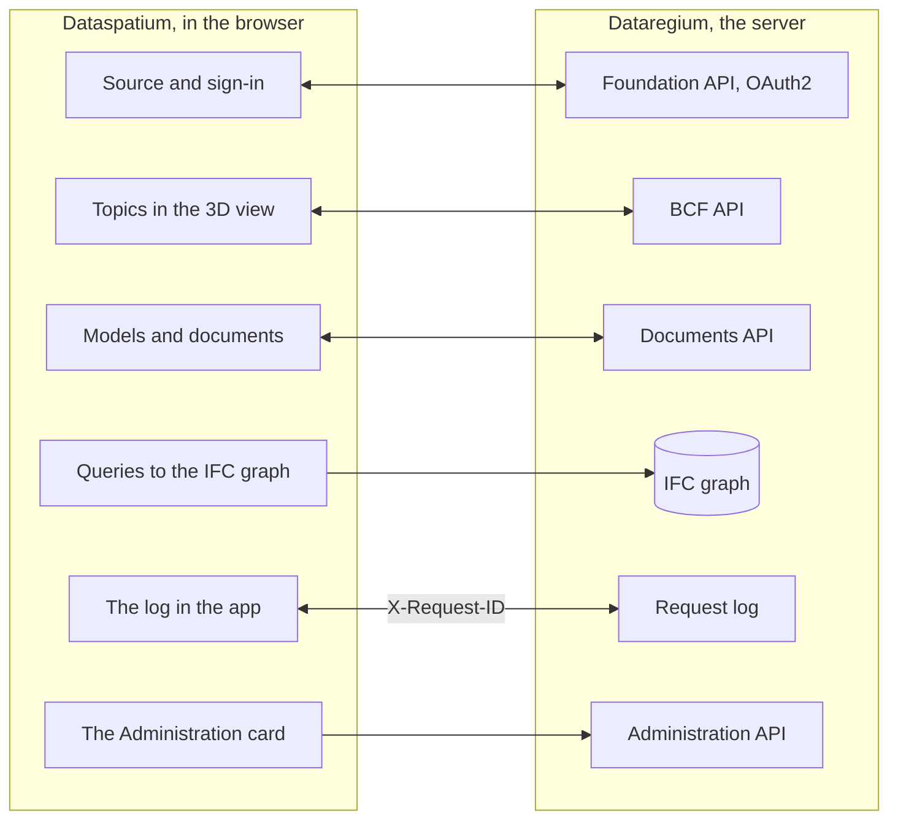

[Svenska](../../README.md) · [Dansk](../da/README.md) · [Norsk bokmål](../nb/README.md) · [Norsk nynorsk](../nn/README.md) · [Suomi](../fi/README.md) · [Íslenska](../is/README.md) · **English**


# Dataregium OpenCDE server

*Dataregium was called Kontroll until 8 November 2026.*

Dataregium is a server where a building project keeps its models, documents and
issues together, so that everyone in the project works from the same material
and sees the same history. You work with it through an app, such as
[Dataspatium](https://github.com/marwiss/Dataspatium) in the browser; the server
itself only has pages for signing in, uploading and administration. Whoever runs
the server decides who may sign in and what each person may do in each project.

Technically, Dataregium is a server for buildingSMART's open **OpenCDE APIs**
(Foundation API 1.0, BCF API 3.0 and 2.1, and Documents API 1.0), built on the
database PostgreSQL. In the third of the server's [three tiers](#what-you-can-do)
every uploaded IFC model becomes a lossless graph in Neo4j or Memgraph through the
[IFC-DB](https://github.com/marwiss/IFC-DB) library, with versions, checks and
proposed changes. The server was rewritten from scratch out of a research
prototype from 2023, with security as the first requirement, and any client that
follows the specifications can connect.


**Contents**

- [Download and get started](#download-and-get-started)
- [Requirements](#requirements)
- [Words to know](#words-to-know)
- [What you can do](#what-you-can-do)
- [The OpenCDE APIs and their clients](#the-opencde-apis-and-their-clients)
- [Dataregium and Dataspatium](#dataregium-and-dataspatium)
- [Learn more](#learn-more)
- [Limitations in brief](#limitations-in-brief)
- [Personal data](#personal-data)
- [Next in the series](#next-in-the-series)
- [Bugs and suggestions](#bugs-and-suggestions)
- [Development](#development)
- [Licence](#licence)

## Download and get started

If you only use Dataregium, you need not install anything: ask whoever runs the
server for its address and an account, and sign in from Dataspatium or another
OpenCDE app. To try the server on your own computer, follow the quick start
below. It takes about twenty minutes and needs Docker Desktop or Podman. If you
are at home with containers and Python, the short way is under
[For the technically skilled](#for-the-technically-skilled).

### Quick start (local, Docker or Podman)

A container is a ready-packed program that runs apart on the computer, and Docker
and Podman are programs that start containers. The quick start starts two: the
server and its database, PostgreSQL. With models, in tier 3, it also starts the
graph database Neo4j.

1. **Download.** Get the code with git, or as a ZIP file under *Code > Download
   ZIP* on GitHub. The `main` branch is the series, in beta, and the tag `v0.1.0`
   is its first release.

   ```sh
   git clone https://github.com/marwiss/Dataregium.git
   cd Dataregium
   ```

2. **Set up.** Copy `.env.example` to `.env`, the file with the server's
   settings, and set `OPENCDE_STORE_PASSWORD`, PostgreSQL's password, to a long
   random value of your own. To try it with Dataspatium and models, which are
   tier 3, also set `OPENCDE_TIER=experimental`, `COMPOSE_PROFILES=graph`,
   `OPENCDE_GRAPH_PASSWORD` to a password of at least 16 characters,
   `OPENCDE_IFC_DB_ENABLED=true`, `OPENCDE_DYNAMIC_CLIENT_REGISTRATION=true` and
   `OPENCDE_REQUEST_LOG_ENABLED=true`; the [quick start with
   Dataspatium](quickstart.md) explains why. `uv run opencde init` writes such a
   `.env` with fresh passwords instead: answer no to other people using the
   server and yes to what the quick start with Dataspatium uses. Every setting
   is explained in [.env.example](../../.env.example).
3. **Start.** The same compose files work with Docker and with Podman; pick the one you have:

   <details open>
   <summary><b>Docker</b></summary>

   ```sh
   docker compose up -d --build
   ```

   starts the server on <http://127.0.0.1:8000> and PostgreSQL, and in tier 3 Neo4j too; the first time takes a few minutes. `docker compose logs -f api` shows the server log.

   </details>

   <details>
   <summary><b>Podman</b></summary>

   ```sh
   podman compose up -d --build
   ```

   does the same with Podman 5 (rootless, no daemon); `podman compose logs -f api` shows the server log. See [deploy/local.md](deploy/local.md) for Podman's particulars.

   </details>

   <details>
   <summary><b>Without a container</b></summary>

   ```sh
   uv sync --extra postgres --extra ifc-db   # installs Python 3.13 and every dependency, with IFC-DB
   uv run opencde doctor                     # checks the configuration and the database
   uv run opencde serve                      # http://127.0.0.1:8000
   ```

   runs the server from the checkout with [uv](https://docs.astral.sh/uv/); it needs PostgreSQL, such as the stack's on `127.0.0.1:5442`, which `.env.example` names, and in tier 3 a graph database too, such as the stack's on `127.0.0.1:7697`: remove the `#` before `OPENCDE_GRAPH_URI` in `.env`.

   </details>

4. **Look around.** <http://127.0.0.1:8000/docs> shows every call the server
   takes and lets you try them, and <http://127.0.0.1:8000/readyz> says whether
   the server and its databases are ready (`"graph":"none"` when it uses no
   graph). PostgreSQL answers on `127.0.0.1:5442`, and in tier 3
   <http://127.0.0.1:7484> is Neo4j Browser, where you see the graph (Bolt on
   `127.0.0.1:7697`). The development overlay avoids the default ports, which
   another PostgreSQL or Neo4j on the same computer often holds.
5. **Load demonstration data and sign in.**

   <details open>
   <summary><b>Docker</b></summary>

   ```sh
   docker compose exec api opencde seed
   ```

   </details>

   <details>
   <summary><b>Podman</b></summary>

   ```sh
   podman compose exec api opencde seed
   ```

   </details>

   <details>
   <summary><b>Without a container</b></summary>

   ```sh
   uv run opencde seed
   ```

   </details>

   The command makes demonstration users, projects, clients and a topic, and with
   IFC-DB on also a sample model as a graph. The passwords are printed once. Sign
   in at <http://127.0.0.1:8000/signin> as `admin` and open `/admin`.
6. **Connect a client.** Register your app under *Clients* (or let it register
   itself when `OPENCDE_DYNAMIC_CLIENT_REGISTRATION=true`) and point it at
   `http://127.0.0.1:8000`; [Dataspatium](#dataregium-and-dataspatium) and the
   Python library in [client/](../../client/) are ready-made clients.
   To sign in from Dataspatium, follow the [quick start](quickstart.md): it covers
   every setting that is needed and what to do if something goes wrong.

### Deployment

For others to use the server, it has to run on a computer that is always on and
reachable from the internet, with an address of its own and https. The table shows
the ways to do that; whoever does not run servers leaves it to someone who does.
Each way is one compose file plus an overlay:

| Scenario | Guide |
|---|---|
| A local test on your computer | [deploy/local.md](deploy/local.md) |
| A public https address for client tests without a server of your own (tunnel) | [deploy/tunnel.md](deploy/tunnel.md) |
| Production on a server of your own with Caddy (automatic TLS) and nightly backups | [deploy/vps-caddy.md](deploy/vps-caddy.md) |
| Beside what already runs on a server, behind its nginx | [deploy/proxied.md](deploy/proxied.md) |
| Coolify, Dokploy, Portainer | [deploy/paas.md](deploy/paas.md) |
| Your own region at AWS, Azure or Google Cloud: one machine, set up by a cloud-init file | [deploy/cloud.md](deploy/cloud.md) |
| A container service plus a managed PostgreSQL and, in tier 3, a managed Neo4j AuraDB or Memgraph Cloud | [deploy/cloud-aura.md](deploy/cloud-aura.md) |
| Backup and restore of PostgreSQL and the graph (portable between Neo4j and Memgraph) | [deploy/backup.md](deploy/backup.md) |

`uv run opencde init --public-url https://cde.example.org` writes a production
`.env` with fresh secrets, PostgreSQL's password among them, for tier 2 (`bim-gis`)
unless `--tier` says `documents` or `experimental`; `opencde doctor` checks the
result. An installation from before, with the server's own data in the graph,
moves to PostgreSQL with a backup and a restore
([deploy/backup.md](deploy/backup.md#from-the-graph-to-postgresql)).

### Configuration

Everything is read from environment variables with the prefix `OPENCDE_`, from
`.env` or from Docker secrets in `/run/secrets/opencde_<name>`. The commented list
is in [.env.example](../../.env.example). The server keeps its own data in
PostgreSQL (`OPENCDE_STORE_URL`, without the password, which is
`OPENCDE_STORE_PASSWORD`), and in tier 3 IFC-DB's models in a graph, Neo4j or
Memgraph (`OPENCDE_GRAPH_URI`), which there also holds the server's own data when
`OPENCDE_STORE_URL` is not set. The defaults are safe: production refuses to start
without a public `https` address and the password of each database it uses, and
nothing is open until it has been configured.

### For the technically skilled

- **Image**: `ghcr.io/marwiss/opencdeserver` for amd64 and arm64, scanned with
  Trivy and with an SBOM. The tags are `0.1.0`, `0.1` and `latest`, and with
  buildingSMART's ifc-gherkin-rules `0.1.0-gherkin`, `0.1-gherkin` and
  `latest-gherkin`; `OPENCDE_IMAGE_TAG` chooses in the compose files.
  `docker/Dockerfile` installs the extras `postgres` and `ifc-db`, and
  `--build-arg OPENCDE_EXTRAS="--extra postgres"` builds a slimmer image without
  IfcOpenShell.
- **Compose**: `docker/compose.yaml` starts the server and PostgreSQL, and the
  graph of tier 3 with `COMPOSE_PROFILES=graph`, plus overlays for development,
  production with Caddy, behind an existing proxy, a tunnel and the local engine,
  and for tier 3 Memgraph, an external graph database, Bolt with TLS, the working
  copy and a small server. `COMPOSE_FILE` in `.env` chooses them, so the commands
  go without `-f`. `OPENCDE_STACK_STORE_URL` names another PostgreSQL, such as a
  managed one, and set but empty keeps the server's own data in the graph, in tier 3.
- **Without a container**: Python 3.11 or later with uv (tested on 3.11, 3.13 and
  3.14), `uv sync --extra postgres --extra ifc-db`, PostgreSQL at
  `OPENCDE_STORE_URL`, and in tier 3 Neo4j 5.26 or Memgraph 3.14 at
  `OPENCDE_GRAPH_URI`.
- **The main settings**: `OPENCDE_TIER` chooses the tier (`documents`, `bim-gis`, the
  default, or `experimental`); `OPENCDE_APIS` chooses the APIs within it (all three
  by default, `["documents"]` in tier 1); `OPENCDE_STORE_URL` names the
  PostgreSQL that holds the server's own data, which tiers 1 and 2 require;
  `OPENCDE_BIM_ENABLED=true` turns on the BIM functions on the files, in tier 2, and
  `OPENCDE_IFC_DB_ENABLED=true` the graph, in tier 3, with what only the graph
  answers; `OPENCDE_ENVIRONMENT` is `development`, `production` or `local` (the
  local engine, `opencde init --local`).
- **Endpoints**: `/.well-known/dataregium` (the version, the tier and the extensions
  that are on), `/foundation/versions`, `/openapi.json` and `/docs`, `/healthz`
  and `/readyz`, `/admin/api` (administration) and `/manage/1.0` (project
  administration). The extensions for the models are under `/documents/1.0/` (the
  versions' `ifc-queries`, `ifc-diff`, `ifc-changes` and `ifc-geometry`, the
  projects' `ifc-precheck` and `ifc-clash`) and under a BCF 3.0 topic (`snippet`
  and `ifc-proposal/approve`).
- **The command line**: `opencde serve`, `init`, `doctor`, `seed`, `backup`,
  `restore`, `revoke`, `cleanup` and the groups `user`, `project`, `client` and
  `ifcgraph`; `uv run opencde --help`.
- **Building a client**: the [client guide](client-guide.md) has the flows, the
  capabilities document, the error codes and the extensions, and
  [docs/examples/](../examples/) runnable examples.

## Requirements

Whoever only uses Dataregium through an app needs a browser and an account. To run
the server yourself:

- Windows, macOS or Linux with Docker (Desktop on Windows/macOS, Engine on Linux)
  or Podman 5, or Python 3.11 or later with [uv](https://docs.astral.sh/uv/) and a
  PostgreSQL 17 database of your own, and in tier 3 a Neo4j 5.26 or Memgraph 3.14
  database too.
- In tier 3, about 1 GB of memory for the graph's container (`NEO4J_HEAP` and
  `NEO4J_PAGECACHE` in `.env`), and more for large models with IFC-DB.
- Locally: port 8000 for the server, 5442 for PostgreSQL and, in tier 3, 7484/7697
  for the graph, all bound to `127.0.0.1`. In production: ports 80 and 443
  reachable from the internet and a DNS name for the server.
- Clients need an `https` address in production; locally `http://127.0.0.1` is
  accepted as a redirect URI, and `http://localhost` with `OPENCDE_ALLOW_LOCALHOST_REDIRECTS=true` (or, while the MCP endpoint is on, for a sign-in to it alone).

## Words to know

The words this README uses, in everyday language; the whole glossary is in
[glossary.md](glossary.md).

- **BIM**: building and managing with a digital model of the building, where every
  wall, door and room is an object with properties and not just lines on a drawing.
- **CAD**: programs for drawings and models; a BIM model is made in a CAD program.
- **IFC**: the open file format for BIM models, which the major programs can read and write.
- **BCF and topics**: an open format for questions and remarks about a model, with
  comments and a view (viewpoint) that shows where in the model it applies.
- **IDS**: a requirement on what a model must contain, for example that every door
  has a fire rating; the server checks the models against the project's requirements.
- **OpenCDE**: buildingSMART's open rules for how the apps and servers in a building
  project talk to each other. CDE stands for common data environment.
- **API**: the way an app talks to the server, with set questions and answers.
- **Server and client**: the server stores and shares the project's material; the
  client is the app you work in, such as Dataspatium.
- **Database and graph**: the database is where the server keeps its accounts,
  projects, documents and topics; Dataregium's is PostgreSQL. A graph database keeps
  things and the connections between them, such as a wall that stands on a storey,
  and can therefore answer questions about how the parts fit together; in tier 3
  the models are kept in one, Neo4j or Memgraph.
- **Tier**: how much a server offers: Documents, BIM + GIS or Experimental, each
  with everything the one before it has.
- **Container**: a ready-packed program that runs apart on the computer; Docker and
  Podman start them.
- **OAuth2**: the safe way to sign in from an app without the app getting your password.
- **Version and change set**: each time a model is saved on the server it becomes a
  new version. A change set is a proposal of changes that someone responsible
  approves before it becomes the next version.

## What you can do

Dataspatium and Dataregium of the same tier work together.

A server offers one of three tiers, which `OPENCDE_TIER` chooses, and each has
everything the one before it has: **Documents** (`documents`) the Foundation API
and the Documents API, **BIM + GIS** (`bim-gis`) also BCF API 3.0 and 2.1 and the
MCP endpoint, and **Experimental** (`experimental`) also IFC-DB's graph in Neo4j or
Memgraph. In tier 2 the BIM functions run on the versions' IFC files with
`OPENCDE_BIM_ENABLED`: the checks, the comparisons, the clash checks, the rooms
and the trials of change sets below. IFC-DB (`OPENCDE_IFC_DB_ENABLED`) belongs
to tier 3 and brings them too, with what only the graph answers: the queries,
the merges and the geometry. A function can be off within its tier but never on
above it: the server refuses to start when `OPENCDE_APIS`, `OPENCDE_MCP_ENABLED`,
`OPENCDE_BIM_ENABLED` or `OPENCDE_IFC_DB_ENABLED` asks for more than the tier
offers, and names the setting, and what needs IFC-DB, such as the working copy,
stays off without it. Tiers 1 and 2 keep the server's own data in PostgreSQL
alone. Unset, the tier is BIM + GIS, as `opencde init` writes, so a server with
IFC-DB or with its own data in a graph sets `OPENCDE_TIER=experimental`. The
capabilities document gives the tier as `tier`, and `opencde doctor` and the
administration's overview show it.

### Tier 1, Documents

- **Documents in one place** (Documents API 1.0): choosing, uploading and fetching
  documents and their versions through the server's pages, from an app such as Dataspatium.
- **Sign-in and apps** (Foundation API 1.0): one account per person, sign-in with
  OAuth2 and PKCE, and apps that an administrator registers or that register
  themselves when the operator allows it (see the [client guide](client-guide.md)).
- **Administration** in the browser (`/admin`) and on the command line: users and
  project roles, projects, clients, sessions, the audit log and the health checks;
  every user has `/account` for their password and their apps.
- **Help for whoever builds an app**, marked as extensions: a capabilities document
  (`/.well-known/dataregium`), a stable error code in every error response and a
  request log.
- **A client library** in Python ([client/](../../client/)) with runnable examples,
  and a published image for every deployment.
- **Project managers administer their project**: a `manager` adds and removes
  members, changes their roles and renames the project, without being a server
  administrator.
- **A region of your own**: ready recipes for a machine of your own at AWS, Azure or
  Google Cloud or beside an existing nginx.

### Also in tier 2, BIM + GIS

- **Topics about the model** (BCF API 3.0 and 2.1): questions and remarks with
  comments, pictures and views that point out building elements, with filters and an
  event log, validated against buildingSMART's schemas.
- **A check of every upload** against the IFC schema, buildingSMART's rules and the
  project's IDS requirements; a project can refuse files with errors, and a file can
  be checked beforehand without being stored.
- **Comparisons**: what changed since a version, a comparison of two versions (also
  on a page on the server) and a clash check whose clashes can become topics.
- **Changes as proposals**: every new version names its base, and a change set in a
  BCF topic is tested and approved by a `manager` into the next version, merged per
  instance with what came in between; a real clash shows the value of the base, of
  the latest version and of the proposal.
- **Publishing**: a `manager` publishes a version whose check found no errors, and the
  server keeps it as one whole `.ifczip` that everyone in the project can download.

### Also in tier 3, Experimental

- **The model as a graph** (the IFC-DB module, turned on with
  `OPENCDE_IFC_DB_ENABLED`): an uploaded IFC model becomes a graph in Neo4j or
  Memgraph, linked to the building elements in the topics' views (see
  [IFC-DB](ifc-db.md)).
- **A lossless model**: the graph comes from the IFC-DB library and holds
  everything in the file, so that it can be written back as it came.
- **Queries**: named queries for members, which the graph answers.
- **A building into another model**: the building of one model comes into another
  project's model as its next version, with a report first of what comes along and
  a choice for each object both have in different forms; a `manager` makes it.
- **The geometry as glTF**: every version as binary glTF with shared meshes and one
  node per building element, and a box per building element in the graph for
  questions about what is near.
- **A local engine**: Dataregium on your own computer behind Dataspatium, with a
  working copy in memory for large models.


## The OpenCDE APIs and their clients

OpenCDE is buildingSMART International's family of open web APIs for a common data
environment, the place where a project shares its models, documents and issues. A
client and a server that follow the same specifications can work together, whoever
built them. Dataregium implements all three:

| API | What it is for | Specification |
|---|---|---|
| Foundation API 1.0 | Says which APIs a server offers, how to sign in and who the user is | [foundation-API](https://github.com/buildingSMART/foundation-API) |
| BCF API 3.0 and 2.1 | Issues about a model, with comments and viewpoints with camera, components and images | [BCF-API](https://github.com/buildingSMART/BCF-API) |
| Documents API 1.0 | Selecting, downloading and uploading documents and their versions, through pages on the server | [documents-API](https://github.com/buildingSMART/documents-API) |

**Dataspatium is one client, not the only one.** Any client that follows these
specifications should be able to connect: nothing on the server depends on Dataspatium,
and the extensions outside the specifications are optional, so a client that does not
know them does not notice them. A client needs three things:

- a registration on the server, made by an administrator under *Clients* or by the client
  itself when `OPENCDE_DYNAMIC_CLIENT_REGISTRATION=true`;
- OAuth2 authorization code with PKCE `S256`, which the server requires of every client but a confidential one an administrator has marked;
- BCF API 3.0, or 2.1 for a client that only speaks that version. `GET /foundation/versions` lists both, and
  [the client guide](client-guide.md) says what differs between them.

How far this has been shown: the server's answers are tested against buildingSMART's
schemas on every push, and Dataspatium and the Python library in [client/](../../client/) run
against the server. Independent clients such as Bonsai and ifc-lite have a prepared
checklist that has not been run yet. If you try a
client, tell us how it went under [Bugs and suggestions](#bugs-and-suggestions). When a client and a
specification disagree, the specification decides. [docs/en/client-guide.md](client-guide.md) is for those
who build a client.

## Dataregium and Dataspatium

Dataspatium is the app you work in, and Dataregium is the server where the
project's shared material is kept. [Dataspatium](https://github.com/marwiss/Dataspatium)
runs wholly in the browser, and the two are developed to work together. The same
tier, not the same release number, means that they work together: Dataspatium
0.1.0 works with Dataregium 0.1.0 at the same tier ([quick start](quickstart.md)).

Dataspatium adds a Dataregium server as a source: the app discovers the APIs through
`/foundation/versions`, signs in with OAuth2 authorization code and PKCE and
registers itself as a public client when dynamic registration is on, lists the
project's models and documents, reads and writes BCF topics with comments and
viewpoints taken from its 3D view and uploads datasets, files and workspace packages
through the Documents API. In tiers 2 and 3 the app publishes versions with a base
version and a check beforehand, sends change sets that the server tests, lets the
project manager approve them and settle clashes and compares versions in 3D, and in
tier 3 it asks the graph named queries; an administrator can also query the graph
with Cypher through the server's read-only endpoint while the server's own data is
in the graph. The app sends `X-Request-ID` on every call, so that the request log
here and the log in the app show the same conversation, reads the server's
capabilities document to see which extensions are on and acts on the error codes
the server puts in its error bodies.

This is how they hang together:



Apart from the marked extensions, everything Dataspatium does with the server goes
through the three OpenCDE APIs, so the app uses nothing that another client cannot
use; see [The OpenCDE APIs and their clients](#the-opencde-apis-and-their-clients).
The two products are installed separately: this repository does not bundle
Dataspatium (the licences differ, AGPL here and PolyForm Strict there), and
Dataspatium's README describes how to get and use the app.

### One series, in beta from 0.1.0

Dataregium is released in one series from the `main` branch, in beta from 0.1.0, and
on the same day as Dataspatium. The three tiers are the same release and the same
image, and `OPENCDE_TIER` chooses the tier. This is what 0.1.0 has in each tier:

| Tier | What 0.1.0 has |
|---|---|
| 1, Documents (`documents`) | A document server: the Foundation API and the Documents API, the web administration, the project administration for the project manager, the request log and the recipes for the cloud and nginx |
| 2, BIM + GIS (`bim-gis`), the default | Also BCF API 3.0 and 2.1 on the same data, the MCP endpoint and, with `OPENCDE_BIM_ENABLED`, the check of every upload, the comparisons, the clash check and the rooms, versions with change proposals that are tested, approved and merged, and the publication of a version |
| 3, Experimental (`experimental`) | Also the IFC-DB module, which makes a lossless graph in Neo4j or Memgraph of every uploaded IFC file, the named queries, a building of one model brought into another, the geometry as glTF and the local engine with a working copy in memory |

The series 1, 2 and 3 are withdrawn: the releases 1.0.0, 2.0.0 and 3.0.0, their
tags and images and the branches `release-1`, `release-2` and `release-3` are
deleted, and the guides point to 0.1.0.

## Learn more

- [quickstart.md](quickstart.md): Dataregium and Dataspatium together in twenty
  minutes, from an empty computer to a topic made in the 3D view.
- [client-guide.md](client-guide.md) and [docs/examples/](../examples/): how to build
  a client, the capabilities document, the error codes, the extensions for the
  models and runnable examples with the Python library in [client/](../../client/).
- [architecture.md](architecture.md): how the parts hang together, what happens to a call and where everything is in the code.
- [glossary.md](glossary.md): the words the documentation uses.
- [flows/](flows/): sequence diagrams of the OAuth2, Documents API and BCF viewpoint flows.
- [graph-schema.md](graph-schema.md): the graph model.
- [ifc-db.md](ifc-db.md): the IFC-DB module, the checks, the versions, the change sets, the geometry and examples of Cypher queries.
- [mcp.md](mcp.md): the MCP endpoint, through which AI programs read the projects' models: turning it on, its tokens, the protocol, the tools, the AI policy and the limits.
- Architecture decisions that stand: the server's own data in PostgreSQL and the
  models in a graph database, opaque tokens instead of JWT, portable Cypher for
  Neo4j and Memgraph, a web interface without a framework, a backup at application
  level, BCF API 2.1 beside 3.0, a lossless IFC graph that reads and writes STEP
  itself and is validated when written, buildingSMART's rules in an environment of
  their own, IFC-DB as a library, a check against the project's IDS, named queries
  for members, a clash check on the server with IfcClash, versions as nodes with
  changes and a base, a local engine that only answers on your own computer and a
  working copy in memory beside the archive.
- [spec/SOURCES.md](../../spec/SOURCES.md): the exact specification versions the
  server is tested against.

The documentation is in this README's seven languages, each language under
`docs/<language>/`; the English under `docs/en/` is the source. CONTRIBUTING is in English.

### Further reading

- [BCF API](https://github.com/buildingSMART/BCF-API), [Foundation API](https://github.com/buildingSMART/foundation-API) and [Documents API](https://github.com/buildingSMART/documents-API):
  the specifications the server follows.
- [IFC](https://github.com/buildingSMART/IFC4.x-development): the file format for building models, and [IDS](https://github.com/buildingSMART/IDS): requirement specifications that models are checked against.
- [RFC 9700](https://www.rfc-editor.org/rfc/rfc9700): today's best current practice for security in OAuth 2.0, and
  [OAuth 2.1](https://datatracker.ietf.org/doc/draft-ietf-oauth-v2-1/), the draft that gathers it.
- [RFC 7636](https://www.rfc-editor.org/rfc/rfc7636) (PKCE), [RFC 8252](https://www.rfc-editor.org/rfc/rfc8252) (apps on the computer or the phone) and
  [RFC 7591](https://www.rfc-editor.org/rfc/rfc7591) (registration of clients).
- [OWASP ASVS](https://owasp.org/www-project-application-security-verification-standard/): the checklist for the security work.

## Limitations in brief

- The BIM functions on the files run in tier 2 with `OPENCDE_BIM_ENABLED=true`, and
  what only the graph answers needs the IFC-DB module, which is off until
  `OPENCDE_IFC_DB_ENABLED=true` and belongs to tier 3
  (`OPENCDE_TIER=experimental`). buildingSMART's rules only run with the
  `-gherkin` image; without it the schema and IDS are checked.
- The server implements BCF API 3.0 and 2.1, not 1.0, whose resources look different.
- Exporting a project as BCFzip is left to the clients; the server stores topics,
  comments and viewpoints as the API defines them.
- The community editions of Neo4j and Memgraph lack read-only database users, so an
  exposed Bolt port gives full access to whoever has the password. The port stays
  closed unless the administrator publishes it on purpose; the administration API's
  read-only graph query (`OPENCDE_GRAPH_QUERY_ENABLED`) gives Cypher without the
  port, and stays off when PostgreSQL holds the server's own data.
- The IFC-DB import, the checks and the testing of change sets run in separate
  processes with memory and time limits (`OPENCDE_IFC_DB_*`); very large models are
  refused instead of being left half imported, or are handled by the local engine.
- The web pages are for signing in, administration, uploading and choosing documents
  and for a version's check and comparison; end users work in a client such as
  Dataspatium or Bonsai.
- The pages are in this README's seven languages (switch at the foot of every page);
  the command line and the APIs' error messages are in English.
- No external review yet. The OAuch and testssl runs are the operator's steps before
  a production deployment.

## Personal data

Whoever runs Dataregium for others is the controller of this. The server stores user
accounts (username, name, optional e-mail, password hash), project memberships, topics
and comments with their authors' names, uploaded files with their uploaders, the IFC
graph with the file's ownership history, the versions with their authors and
approvers, the change proposals with who proposed them and, where an AI did it, which
AI model and which tool call, and an audit log of who did what and from which address.
Passwords, tokens and secrets are stored only as hashes. Tokens, sessions, upload
sessions and unused self-registered clients expire and are cleaned up by the server;
the audit log is pruned by the operator. An administrator deletes an account under
`/admin/users`, and its sessions and tokens go with it; the name stays on the topics
and versions the person wrote until they are deleted. The audit log is exported as
CSV, BCF and document data through the APIs and the whole database with
`opencde backup`. What Dataspatium keeps in the browser is in the app's own documentation.

## Next in the series

0.1.0 is the series' first release, in beta, and what it has
today is under [What you can do](#what-you-can-do). The official OpenCDE APIs stay as
buildingSMART defines them; what the series adds are extensions to them, under names
of their own and with an OpenAPI of their own. This section says what is decided, for
whoever, human or AI agent, carries a part of it further. The ways of working are in
[CONTRIBUTING.md](../../CONTRIBUTING.md) and the IFC graph in [ifc-db.md](ifc-db.md).

### Decided

- **Editing models in Native IFC** in tier 3. Create is the upload, Read the named queries,
  Update and Delete a change set (setting, adding, removing and copying instances)
  that is tested and approved, and Export writing STEP back. The data keeps to IFC,
  ifc-gherkin-rules and the project's IDS, on import and after every change.
- **Versions in git in tier 2.** Every version of a text file, such as an IFC file in
  STEP, becomes a commit in a git repository per project on the server, and Bruno
  Postle's [ifcmerge](https://github.com/brunopostle/ifcmerge) does all merging: an
  upload against an older base is merged, and a proposal becomes a branch. GitHub and
  other forges can be the repository's remote, and a deleted STEP id never comes back.
- **BIM snippets as a working demonstration.** A proposed change travels as a
  `bim_snippet` in a BCF 3.0 topic, with a published schema behind its
  `reference_schema`, so that the change, the discussion and the decision are in one
  place. buildingSMART's unreleased development branches have removed them; Dataregium
  builds them to show how they could work. A snippet points out what it changes with
  a GlobalId and a path of IFC attribute names from there, with a STEP id only where
  no GlobalId reaches; GlobalId and path reached 98 to 100 per cent of the instances
  in 28 sample files.
- **Who may change what.** `editor` proposes, `manager` approves, and an AI only
  proposes; every change carries who proposed it, and which AI model and which tool
  call, where an AI did it. A team of the project, whose IDS document points out its
  part of the model as ISO 19650's task teams do, has its responsible approve the
  changes to that part; a change across several teams' parts goes to a `manager`.
- **A clash check in both places**: on the server with IfcOpenShell's IfcClash and in
  Dataspatium with its own core in JavaScript.
- **Next**: AI in tier 2 through IfcMCP behind the MCP endpoint, where AI proposes and
  a human approves; a geodata server with OGC API – Features and Tiles on PostGIS;
  buildingSMART's findings linked to building elements; and proprietary formats
  through the source programs' IFC export.

## Bugs and suggestions

Report bugs and wishes as *Issues* here on GitHub. Say which server version
you run (the `version` of `/.well-known/dataregium` or `/healthz`), which client
you used and the `X-Request-ID` of a failing call; the request log and your
client's log share it. Attach no personal data and no secrets. How changes are
taken in is in [CONTRIBUTING.md](../../CONTRIBUTING.md). For a security
vulnerability follow [SECURITY.md](../../SECURITY.md) instead of opening an issue.

## Development

```sh
uv run pytest                    # unit, conformance and security tests
uv run pytest -m integration     # starts Neo4j/Memgraph with testcontainers (Docker required)
uv run pytest -m e2e             # the client library against a live server (Docker required)
uv run pytest -m ui              # Playwright + axe-core (uv sync --group ui; playwright install chromium)
uv run ruff format . && uv run ruff check .
uv run ty check opencde client/opencde_client
```

Code and comments are in English, and the style follows IfcOpenShell's
conventions (ruff, 120 columns), so that contributing the server to
IfcOpenShell stays possible. The README exists in English, Swedish, Danish,
Norwegian (Bokmål and Nynorsk), Finnish and Icelandic (`docs/<lang>/README.md`,
the layout Dataspatium uses); the documentation and the web UI are
available in the same languages, with English always one of the choices, and
shared terms follow Dataspatium's glossary. Every push runs linting, type
checks, the test suites on three Python versions, browser tests with axe-core,
and static security checks; nightly jobs run OWASP ZAP, Schemathesis and
Trivy. See [CONTRIBUTING.md](../../CONTRIBUTING.md).

## Licence

The server is licensed under the GNU Affero General Public License v3.0 or
later ([LICENSE](../../LICENSE)): it is server software, and the AGPL's network
clause keeps improvements to hosted instances open. The client library in
[client/](../../client/) is LGPL-3.0-or-later. Specification files under
[spec/](../../spec/) are © buildingSMART International and redistributed unmodified
for testing. See [SECURITY.md](../../SECURITY.md) for how to report a vulnerability
and what the project does to stay secure.
