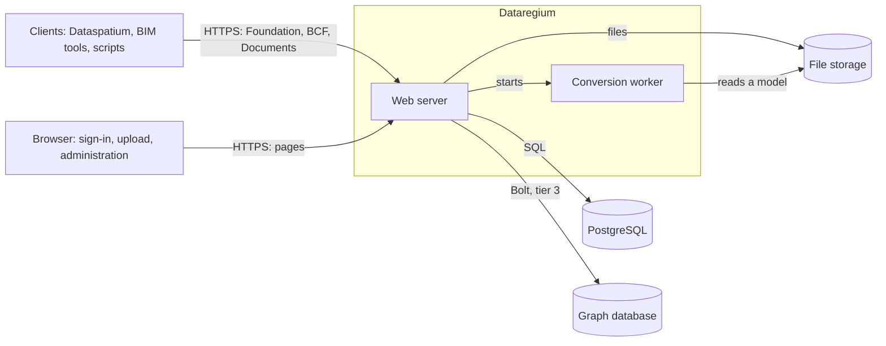

# Architecture

Dataregium is one web server in front of PostgreSQL and, in tier 3, a graph
database. This page shows how the parts fit together, what happens to a request
and where each thing lives in the code. Read it if you want to run the server
with confidence, change it or build on it. The words are explained in the
[glossary](glossary.md).

## The parts

| Part | What it does | Code |
|---|---|---|
| Foundation API | Says which APIs the server offers, how to sign in and who you are | `opencde/foundation/` |
| Sign-in | OAuth2 with PKCE, tokens, clients, the sign-in pages and the wait after failed attempts | `opencde/auth/`, `opencde/web/` |
| BCF API | Topics, comments, viewpoints, events, related topics and project documents | `opencde/bcf/` |
| Documents API | Upload and selection through pages in the browser, versions and metadata | `opencde/documents/` |
| Accounts | Users, projects, memberships and roles | `opencde/accounts/` |
| Storage | The server's own data by area: accounts, OAuth2, BCF, Documents, jobs and the logbook (the audit log, the request log and the sign-in waits), each a repository behind a protocol, with its SQL for PostgreSQL and its Cypher for a graph; apart from the IFC graph, which IFC-DB keeps | `opencde/store/` |
| Administration | Pages and an API for administrators, health checks and the request log | `opencde/admin/`, `opencde/requestlog.py` |
| IFC-DB | Turns uploaded models into nodes and links viewpoint components to them | `opencde/ifcgraph/` |
| MCP endpoint | Tools through which AI programs read the projects' models and propose, while a person approves | `opencde/mcp/` |
| PostgreSQL layer | The pool, the tables and their migrations, and what expires | `opencde/postgres/` |
| Graph layer | The driver, the two database dialects, the schema and what expires | `opencde/graph/` |
| Pages | Templates, styles, scripts and the language catalogues | `opencde/ui/` |

## The way of a request

1. uvicorn takes the request. It believes `X-Forwarded-For` only from the
   proxies in `OPENCDE_TRUSTED_PROXIES`, so the client's address is the real one.
2. The middleware in `opencde/main.py` gives the request an id, logs it without
   bodies or tokens, limits its size, answers CORS and conditional requests, adds
   the security headers and applies the rate limit.
3. The route's dependencies find out who is asking: a bearer token for the APIs
   (`opencde/auth/dependencies.py`), a session cookie for the pages
   (`opencde/web/dependencies.py`).
4. A repository asks PostgreSQL or the graph, with parameters only. Every query
   for project data starts at the user and goes through the membership
   (`memberships` in PostgreSQL, `MEMBER_OF` in the graph), so what a user is
   not a member of does not exist for them and answers 404.
5. The answer follows the schemas in `spec/`, and every error has the same form
   (`opencde/errors.py`).

## Tiers

`OPENCDE_TIER` says what the server offers, and each tier holds the ones below
it.

| Tier | `OPENCDE_TIER` | What it adds |
|---|---|---|
| 1, Documents | `documents` | The Foundation and Documents APIs |
| 2, BIM + GIS | `bim-gis` | BCF API 3.0 and 2.1, the MCP endpoint, and the BIM functions on the IFC files (`OPENCDE_BIM_ENABLED`): the checks, the diff, the clash check, the rooms and the change sets' trial |
| 3, Experimental | `experimental` | IFC-DB's graph (`OPENCDE_IFC_DB_ENABLED`, Neo4j or Memgraph), which brings the BIM functions too and adds the named queries, the geometry and the merge, and the server's own data in a graph |

A function can be off within the tier but never on above it: the server refuses
to start, and names the setting, when the APIs, the MCP endpoint, the BIM
functions or IFC-DB ask for more than the tier offers. In tier 1 `OPENCDE_APIS`
is `["documents"]` unless it is set. Tiers 1 and 2 keep the server's own data in
PostgreSQL alone, so they need `OPENCDE_STORE_URL`. Without `OPENCDE_TIER` the
tier is bim-gis, as `opencde init` writes, so a server with IFC-DB or with its own
data in a graph, as before the tiers, sets `OPENCDE_TIER=experimental`; it refuses
to start until then, and says so.
`GET /.well-known/dataregium` names the tier in `tier`, and `opencde doctor` and
the administration's overview show it.

## Where the data lives

| What | Where | Read more |
|---|---|---|
| Users, projects, topics, comments, viewpoints, document metadata, clients and the audit log | PostgreSQL, or the graph database in tier 3 without `OPENCDE_STORE_URL` | `opencde/postgres/migrations/`, [Graph schema](graph-schema.md) |
| Tokens, codes and client secrets, as SHA-256 hashes; passwords, as Argon2id hashes | The same place | `tests/security/` |
| Uploaded files and viewpoint images, under names the server chooses | File storage in `OPENCDE_DATA_DIR` | [Documents API flows](flows/documents.md) |
| Models as nodes and relationships | The graph database, tier 3 | [IFC-DB](ifc-db.md) |
| The server's own settings and secrets | `.env` or `/run/secrets` | [Local test](deploy/local.md) |

An installation from before, with the server's own data in the graph, moves to
PostgreSQL with a backup and a restore: see
[From the graph to PostgreSQL](deploy/backup.md#from-the-graph-to-postgresql).

## Work outside requests

- Every minute (`OPENCDE_CLEANUP_INTERVAL_SECONDS`) the server deletes what has
  expired, such as codes, tokens, sessions and unfinished uploads, and takes up
  conversions a stopped server left behind.
- IFC conversions run one at a time in a process of their own, with limits on
  time and memory, so a broken model cannot take the server down.
- When the request log is on (`OPENCDE_REQUEST_LOG_ENABLED`), a writer stores the
  requests where the server's own data is, one at a time in the background, and
  the server deletes them every minute once their `expires_at` has passed.

## Safe by default

- Nothing is open until someone opens it: self-registration of clients, the IFC
  graph, the request log and graph queries are off by default.
- In production the server refuses to start without https and a database password.
- The pages have no inline scripts or styles, every form has a signed token, and
  every page works without JavaScript.

Every measure here has a test behind it in `tests/security/`.

## The databases

PostgreSQL holds the server's own data, in the tables that
`opencde/postgres/migrations/` defines (ADR 0029). The graph runs on Neo4j or
Memgraph with the same Cypher. Only the schema statements differ, and they live
in `opencde/graph/dialect.py` together with the list of functions the code must
not use.

At start the server waits for each database it uses, which in tiers 1 and 2 is
PostgreSQL alone. `GET /readyz` is ready when they answer. Without a graph it
answers
`{"status":"ready","graph":"none","store":"ok","workcopy":"none","store_dialect":"postgres"}`,
and 503 with `{"status":"not_ready","graph":"none","store":"unavailable"}` while
PostgreSQL does not answer. A request that cannot reach PostgreSQL or the graph
answers 503 with the code `unavailable`.

## How it is tested

| Folder | What it proves | When it runs |
|---|---|---|
| `tests/unit` | Functions and documents, without a database | Every push |
| `tests/conformance` | Routes and answers against the schemas in `spec/` | Every push |
| `tests/security` | Headers, tokens, limits, and that every operation asks for a token | Every push |
| `tests/integration` | Everything against a real database in Docker | Every push; on Memgraph too every night |
| `tests/ui` | The pages in a real browser, with an accessibility check | Every push |
| `tests/e2e` | The client library against a running server, generated requests, and a restart of the whole stack | Every push; the long runs every night |

## Read on

- [Quick start](quickstart.md): the server and Dataspatium on your own machine.
- [Client guide](client-guide.md): how to build a client.
- [MCP endpoint](mcp.md): what AI programs reach, and how.
- [Flows](flows/oauth2.md): sign-in, [documents](flows/documents.md) and
  [BCF viewpoints](flows/bcf-viewpoint.md) as sequence diagrams.
