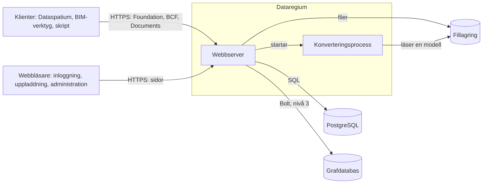

# Arkitektur

Dataregium är en webbserver framför PostgreSQL och, i nivå 3, en grafdatabas.
Den här sidan visar hur delarna hänger ihop, vad som händer med ett anrop och var
allt finns i koden. Läs den om du vill driva servern med trygghet, ändra den eller
bygga vidare på den. Orden förklaras i [ordlistan](glossary.md).

## Delarna

| Del | Vad den gör | Kod |
|---|---|---|
| Foundation API | Säger vilka API:er servern erbjuder, hur man loggar in och vem du är | `opencde/foundation/` |
| Inloggning | OAuth2 med PKCE, token, klienter, inloggningssidorna och väntetiden efter misslyckade försök | `opencde/auth/`, `opencde/web/` |
| BCF API | Ärenden, kommentarer, viewpoints, händelser, relaterade ärenden och projektdokument | `opencde/bcf/` |
| Documents API | Uppladdning och urval via sidor i webbläsaren, versioner och metadata | `opencde/documents/` |
| Konton | Användare, projekt, medlemskap och roller | `opencde/accounts/` |
| Lagringen | Serverns egna data per område: konton, OAuth2, BCF, Documents, jobb och loggboken (granskningsloggen, begärandeloggen och väntan efter misslyckade inloggningar), var och en en repository-klass bakom ett protokoll, med sin SQL för PostgreSQL och sin Cypher för en graf; skild från IFC-grafen, som IFC-DB håller | `opencde/store/` |
| Administration | Sidor och ett API för administratörer, hälsokontroller och begärandeloggen | `opencde/admin/`, `opencde/requestlog.py` |
| IFC-DB | Gör uppladdade modeller till noder och länkar viewpoint-komponenter till dem | `opencde/ifcgraph/` |
| MCP-ändpunkten | Verktyg genom vilka AI-program läser projektens modeller och föreslår, medan en person godkänner | `opencde/mcp/` |
| PostgreSQL-lagret | Poolen, tabellerna och deras migreringar, och det som löper ut | `opencde/postgres/` |
| Graflagret | Drivrutinen, de två databasdialekterna, schemat och det som löper ut | `opencde/graph/` |
| Sidor | Mallar, stilar, skript och språkkatalogerna | `opencde/ui/` |

## Ett anrops väg

1. uvicorn tar emot anropet. Den tror på `X-Forwarded-For` bara från proxyerna i
   `OPENCDE_TRUSTED_PROXIES`, så klientens adress är den riktiga.
2. Middleware i `opencde/main.py` ger anropet ett id, loggar det utan innehåll och
   token, begränsar storleken, svarar på CORS och villkorliga anrop, lägger till
   säkerhetshuvudena och tillämpar gränsen för antal anrop.
3. Routens beroenden tar reda på vem som frågar: en bearer-token för API:erna
   (`opencde/auth/dependencies.py`), en sessionskaka för sidorna
   (`opencde/web/dependencies.py`).
4. Ett repository frågar PostgreSQL eller grafen, bara med parametrar. Varje fråga
   efter projektdata börjar hos användaren och går genom medlemskapet
   (`memberships` i PostgreSQL, `MEMBER_OF` i grafen), så det en användare inte är
   medlem i finns inte för hen och svarar 404.
5. Svaret följer schemana i `spec/`, och alla fel har samma form
   (`opencde/errors.py`).

## Nivåer

`OPENCDE_TIER` säger vad servern erbjuder, och varje nivå rymmer nivåerna under
sig.

| Nivå | `OPENCDE_TIER` | Vad den lägger till |
|---|---|---|
| 1, Dokument | `documents` | Foundation API och Documents API |
| 2, BIM och GIS | `bim-gis` | BCF API 3.0 och 2.1 och MCP-ändpunkten |
| 3, Experimentell | `experimental` | IFC-DB:s graf (`OPENCDE_IFC_DB_ENABLED`, Neo4j eller Memgraph), och serverns egna data i en graf |

En funktion kan vara avstängd inom nivån men aldrig påslagen ovanför den:
servern vägrar starta, och namnger inställningen, när API:erna, MCP-ändpunkten
eller IFC-DB begär mer än nivån erbjuder. I nivå 1 är `OPENCDE_APIS`
`["documents"]` om den inte är satt. Nivå 1 och 2 håller serverns egna data bara
i PostgreSQL och behöver därför `OPENCDE_STORE_URL`. Utan `OPENCDE_TIER` är
nivån experimentell: inget hålls tillbaka, som före nivåerna.
`GET /.well-known/dataregium` anger nivån i `tier`, och `opencde doctor` och
administrationens översikt visar den.

## Var data finns

| Vad | Var | Läs mer |
|---|---|---|
| Användare, projekt, ärenden, kommentarer, viewpoints, dokumentmetadata, klienter och granskningsloggen | PostgreSQL, eller grafdatabasen i nivå 3 utan `OPENCDE_STORE_URL` | `opencde/postgres/migrations/`, [Grafschema](graph-schema.md) |
| Token, koder och klienthemligheter som SHA-256-hashar; lösenord som Argon2id-hashar | På samma ställe | `tests/security/` |
| Uppladdade filer och viewpoint-bilder, under namn som servern väljer | Fillagringen i `OPENCDE_DATA_DIR` | [Documents API-flöden](flows/documents.md) |
| Modeller som noder och relationer | Grafdatabasen, nivå 3 | [IFC-DB](ifc-db.md) |
| Serverns egna inställningar och hemligheter | `.env` eller `/run/secrets` | [Lokalt test](deploy/local.md) |

En installation från tidigare, med serverns egna data i grafen, flyttar till
PostgreSQL med en säkerhetskopia och en återställning: se
[Från grafen till PostgreSQL](deploy/backup.md#från-grafen-till-postgresql).

## Arbete utanför anropen

- Varje minut (`OPENCDE_CLEANUP_INTERVAL_SECONDS`) tar servern bort det som löpt ut,
  som koder, token, sessioner och oavslutade uppladdningar, och tar upp
  konverteringar som en stoppad server lämnat efter sig.
- IFC-konverteringar körs en i taget i en egen process, med gränser för tid och
  minne, så att en trasig modell inte kan fälla servern.
- När begärandeloggen är på (`OPENCDE_REQUEST_LOG_ENABLED`) sparar en skrivare
  anropen där serverns egna data finns, ett i taget i bakgrunden, och servern
  tar bort dem varje minut när deras `expires_at` har passerat.

## Säker från början

- Inget är öppet förrän någon öppnar det: självregistrering av klienter, IFC-grafen,
  begärandeloggen och graffrågor är avstängda från början.
- I produktion vägrar servern starta utan https och databaslösenord.
- Sidorna har inga inbäddade skript eller stilar, varje formulär har en signerad
  token och varje sida fungerar utan JavaScript.

Varje åtgärd här har ett prov bakom sig i `tests/security/`.

## Databaserna

PostgreSQL håller serverns egna data, i de tabeller som
`opencde/postgres/migrations/` definierar (ADR 0029). Grafen kör på Neo4j eller
Memgraph med samma Cypher. Bara schemasatserna skiljer sig, och de finns i
`opencde/graph/dialect.py` tillsammans med listan över funktioner som koden inte
får använda.

Vid start väntar servern på varje databas den använder, vilket i nivå 1 och 2 är
bara PostgreSQL. `GET /readyz` är redo när de svarar. Utan graf svarar den
`{"status":"ready","graph":"none","store":"ok","workcopy":"none","store_dialect":"postgres"}`,
och 503 med `{"status":"not_ready","graph":"none","store":"unavailable"}` medan
PostgreSQL inte svarar. Ett anrop som inte når PostgreSQL eller grafen svarar
503 med koden `unavailable`.

## Så provas den

| Mapp | Vad den visar | När den körs |
|---|---|---|
| `tests/unit` | Funktioner och dokument, utan databas | Vid varje push |
| `tests/conformance` | Routes och svar mot schemana i `spec/` | Vid varje push |
| `tests/security` | Huvuden, token, gränser och att varje operation kräver token | Vid varje push |
| `tests/integration` | Allt mot en riktig databas i Docker | Vid varje push; även på Memgraph varje natt |
| `tests/ui` | Sidorna i en riktig webbläsare, med tillgänglighetskontroll | Vid varje push |
| `tests/e2e` | Klientbiblioteket mot en körande server, genererade anrop och en omstart av hela stacken | Vid varje push; de långa körningarna varje natt |

## Läs vidare

- [Snabbstart](quickstart.md): servern och Dataspatium på din egen dator.
- [Bygga en klient](client-guide.md): det som en klient behöver.
- [MCP-ändpunkten](mcp.md): vad AI-program når, och hur.
- [Flöden](flows/oauth2.md): inloggning, [dokument](flows/documents.md) och
  [BCF-viewpoints](flows/bcf-viewpoint.md) som sekvensdiagram.
